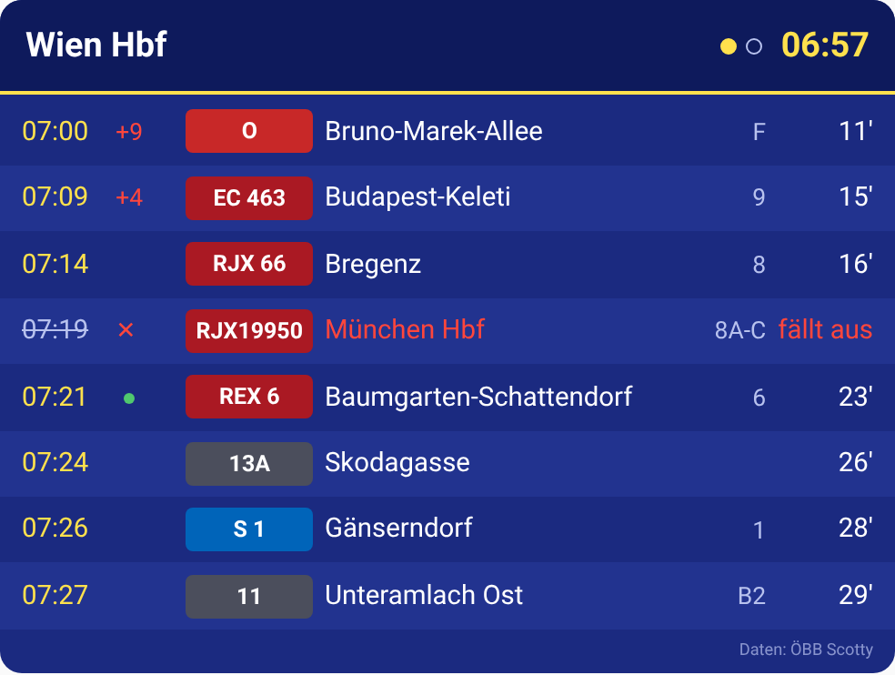
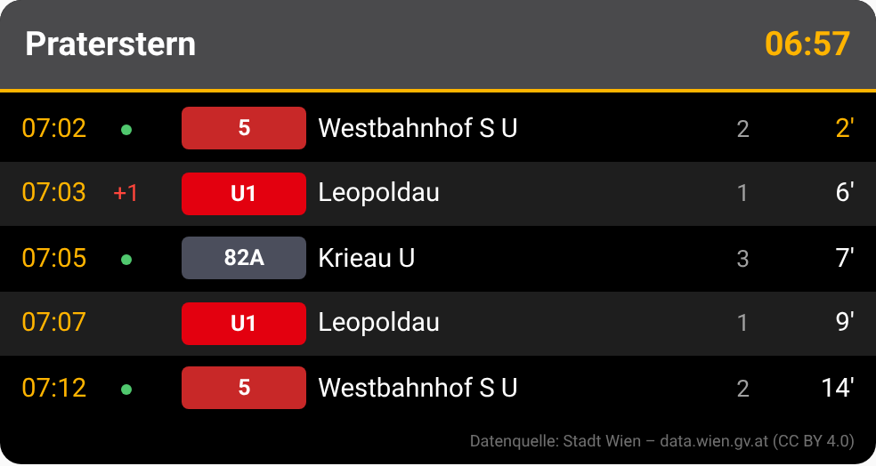
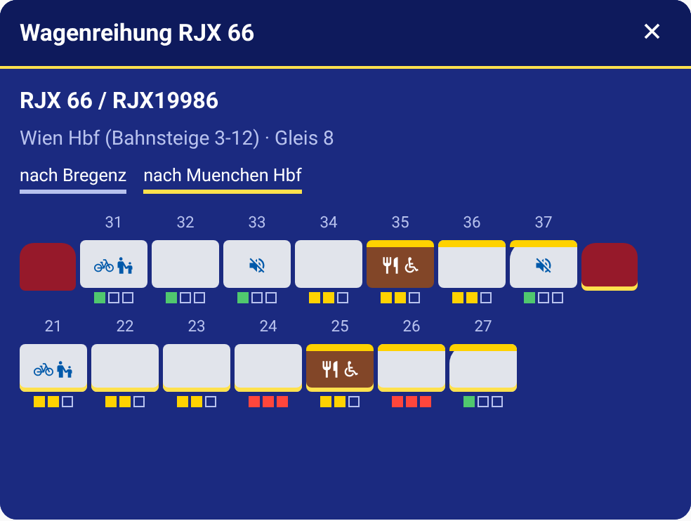

# Grad no! für Home Assistant

[](https://hacs.xyz/docs/faq/custom_repositories)
[](https://github.com/emils1988/grad-no-homeassistant/actions/workflows/validate.yml)

Abfahrten von **ÖBB** und **Wiener Linien** in Home Assistant, mit einer Abfahrtstafel-Karte im Look der
[Grad-no!-Anzeige](https://github.com/emils1988/grad-no). Für die Integration brauchst du **keine** Hardware:
Home Assistant holt die Daten selbst.

<p align="center">
  
  
</p>

## Was du bekommst

- **Ganz Österreich über ÖBB Scotty:** Bahn, Postbus, Stadtverkehr (auch Graz Linien, Linz AG usw.),
  mit Verspätungen, Ausfällen, Gleis und geänderten Zielen.
- **Wiener Linien in Echtzeit:** direkt aus der offenen Schnittstelle der Stadt Wien.
- **Filter wie an der Anzeige:** Linien, Richtung, nur Züge bzw. nur Bus/Tram/U-Bahn, Gehzeit
  (nicht mehr erreichbare Abfahrten ausblenden) und Vorschau bis 24 Stunden.
- **Sensor „Nächste Abfahrt“** pro Haltestelle (Zeitstempel). Die ganze Tafel steht in den Attributen, ideal für Automationen.
- **Wagenreihung** für ÖBB-Fernverkehrszüge: in der Karte auf den Zug tippen oder per Aktion `grad_no.get_formation`.
- **Abfahrtstafel-Karte** mit den Designs Standard, ÖBB und Wiener Linien, Countdown, Linienfarben und
  automatischem Wechsel zwischen mehreren Haltestellen.

Einrichtung komplett über die Oberfläche, ohne YAML und ohne API-Schlüssel.

## Installation

### Über HACS

1. HACS öffnen → Menü (⋮) → **Benutzerdefinierte Repositories**.
2. `https://github.com/emils1988/grad-no-homeassistant` eintragen, Typ **Integration**, hinzufügen.
3. „Grad no!“ suchen und herunterladen.
4. Home Assistant neu starten.

### Manuell

Den Ordner `custom_components/grad_no` in den Ordner `custom_components` deiner Home-Assistant-Konfiguration kopieren
und Home Assistant neu starten.

## Einrichten

**Einstellungen → Geräte & Dienste → Integration hinzufügen → „Grad no!“**

1. Datenquelle wählen und einen Teil des Haltestellennamens eingeben, zum Beispiel „Villach Hbf“ oder „Praterstern“.
2. Haltestelle aus der Trefferliste wählen, optional Filter setzen.

Jede Haltestelle ist ein eigener Eintrag. Du kannst dieselbe Haltestelle auch mehrmals mit verschiedenen Filtern
anlegen, zum Beispiel einmal „nur Richtung Villach“ und einmal „nur Bus 11“.
Filter und Abfrageintervall (mindestens 30 Sekunden, Standard 60) lassen sich später unter **Konfigurieren** ändern.

| Filter | Beispiel | Wirkung |
|---|---|---|
| Verkehrsmittel | Nur Züge | nur Züge bzw. nur Bus, Straßenbahn und U-Bahn |
| Linien | `S1, REX 7, 5110` | nur diese Linien (ganze Linie oder Nummer) |
| Richtung | `Villach, Spittal` | nur Abfahrten, deren Ziel einen dieser Begriffe enthält |
| Gehzeit | 5 min | Abfahrten in den nächsten 5 Minuten ausblenden |
| Vorschau | 60 min | nur Abfahrten in den nächsten 60 Minuten (bis 1440) |

## Die Karte

Die Karte wird mit der Integration mitgeliefert, du musst sie nicht extra installieren.
Im Dashboard **Karte hinzufügen → „Grad no! Abfahrtstafel“** wählen. Alle Einstellungen gehen auch im visuellen Editor.

```yaml
type: custom:grad-no-card
entities:
  - sensor.villach_hbf_nachste_abfahrt
  - sensor.praterstern_nachste_abfahrt
theme: auto          # auto | standard | oebb | wl
rows: 8
auto_rotate: 30      # Sekunden, 0 = aus
show_platform: true
show_clock: true
```

| Option | Standard | Bedeutung |
|---|---|---|
| `entities` | – | ein oder mehrere Grad-no!-Sensoren |
| `title` | Name der Haltestelle | eigener Titel |
| `theme` | `auto` | `auto` = ÖBB-Blau für Scotty, Schwarz/Grau für Wiener Linien |
| `rows` | 8 | Anzahl der Zeilen |
| `auto_rotate` | 0 | bei mehreren Haltestellen alle x Sekunden weiterschalten |
| `show_platform` | `true` | Gleis/Steig anzeigen |
| `show_clock` | `true` | Uhr in der Kopfzeile |

Bedienung wie an der Anzeige: **Tipp auf die Kopfzeile** wechselt zur nächsten Haltestelle
(bei nur einer Haltestelle öffnet sich der Sensor). **Tipp auf einen Fernverkehrszug** (RJ, RJX, IC, EC, NJ …) zeigt die Wagenreihung
mit 1. Klasse, Speisewagen, Fahrrad- und Rollstuhlplätzen und, wenn verfügbar, der Auslastung.

<p align="center"></p>

## Sensor und Attribute

`sensor.<haltestelle>_nachste_abfahrt` hat als Wert die Zeit der nächsten Abfahrt, die nicht ausfällt.

| Attribut | Inhalt |
|---|---|
| `station` | Name der Haltestelle laut Fahrplan |
| `line`, `destination`, `platform`, `delay` | Linie, Ziel, Gleis und Verspätung (Minuten) der nächsten Abfahrt |
| `departures` | Liste aller Abfahrten (bis 20) mit `time`, `rt_time`, `line`, `kind`, `destination`, `destination_changed`, `platform`, `delay`, `cancelled`, `planned`, `departure`, `date`, `train_number` |

`delay` ist `null`, wenn es für diese Fahrt keine Echtzeitdaten gibt. Die Tafel wird nicht in der Datenbank gespeichert.

Beispiel: Benachrichtigung, wenn der Zug ausfällt.

```yaml
triggers:
  - trigger: template
    value_template: >
      {{ state_attr('sensor.villach_hbf_nachste_abfahrt', 'departures')
         | selectattr('line', 'eq', 'REX 7') | selectattr('cancelled') | list | count > 0 }}
actions:
  - action: notify.mobile_app_handy
    data:
      message: "Der REX 7 fällt heute aus."
```

## Aktion `grad_no.get_formation`

Liefert die Wagenreihung als Antwort, zum Beispiel für Skripte:

```yaml
action: grad_no.get_formation
data:
  train_number: 66
  station: Wien Hbf
response_variable: wagenreihung
```

## Datenquellen und Hinweise

- **ÖBB Scotty** und **ÖBB Live** sind die Schnittstellen der ÖBB-Fahrplanauskunft bzw. von live.oebb.at. Sie sind
  nicht offiziell dokumentiert, laufen aber seit Jahren stabil. Bitte das Abfrageintervall nicht unnötig kurz stellen.
- **Wiener Linien:** Datenquelle Stadt Wien – [data.wien.gv.at](https://data.wien.gv.at), Lizenz CC BY 4.0.
- Dieses Projekt steht in keiner Verbindung zu ÖBB oder Wiener Linien.

## Hardware

Die gleiche Tafel gibt es auch als Schreibtisch-Anzeige für unter 20 € (ESP32 „Cheap Yellow Display“)
mit Gehäuse zum Drucken: [github.com/emils1988/grad-no](https://github.com/emils1988/grad-no).

---

## English

Departures for **ÖBB** (all of Austria via Scotty) and **Wiener Linien** (real time) in Home Assistant, plus a
departure-board card in the style of the [Grad no! display](https://github.com/emils1988/grad-no). No hardware needed.
Install via HACS as a custom repository (type *Integration*), then add the "Grad no!" integration, search for your stop
and pick optional filters (lines, direction, trains only / bus only, walking time, look-ahead). Each stop provides a
`Next departure` timestamp sensor with the full board in its attributes. The bundled card (`custom:grad-no-card`) shows
the board in ÖBB, Wiener Linien or amber style; tap a long-distance train to see its coach formation
(`grad_no.get_formation`).

## Lizenz

MIT
